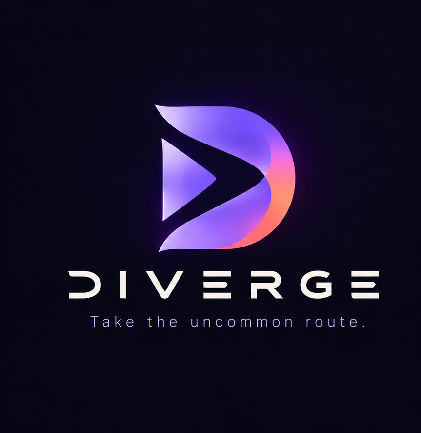

# DIVERGE — Music Streaming Platform

<p align="center">
  
</p>

<p align="center">
  <strong>Take the uncommon route.</strong>
</p>

---

### Project & Evaluation Overview
* **Author / Intern:** **Dharshan V**
* **Role / Title:** Software Developer
* **Program:** **Tech Vedhu Internship Project Submission**
* **Primary Track:** Full-Stack Web Development (Go, SvelteKit, PostgreSQL)
* **Project Scope:** Core Music Streaming, Diverge Sessions, Track DNA, Anti-Algorithm, Trace Journey, Offline Storage
* **Development Timeline:** Initiated October 10, 2026 | 45-Day Capstone Milestone
* **Submission Date:** October 30, 2026
* **Version:** 1.0 Production Candidate

#### Live Production Application
* **Official Web Application:** [https://diverge-music.vercel.app](https://diverge-music.vercel.app)

#### Contact & Developer Profiles
* **Portfolio:** [dharshanvportfolio.netlify.app](https://dharshanvportfolio.netlify.app/)
* **GitHub:** [github.com/Dharsh606](https://github.com/Dharsh606)
* **Repository:** [github.com/Dharsh606/DIVERGE](https://github.com/Dharsh606/DIVERGE)
* **LinkedIn:** [linkedin.com/in/dharshanvreddy](https://www.linkedin.com/in/dharshanvreddy)
* **Email:** dharshan.vreddy2819@gmail.com
* **Phone:** +91 6382546285

---

## 1. Core Architecture

DIVERGE is an asynchronous, high-throughput digital audio platform engineered with an idiomatic **Go (Fiber)** backend and a reactive **SvelteKit** frontend, backed by **PostgreSQL 16** and full-length Creative Commons / Jamendo CDN audio streams.

```
                                  +-------------------+
                                  |   Web Browser     |
                                  | (SvelteKit Client)|
                                  +---------+---------+
                                            |
                         REST API & Auth    |   Audio Stream / Range Requests
                           (Port 5173)      |   (Port 8080)
                                            v
                                  +-------------------+
                                  |    Go Backend     |
                                  |   (Fiber v2.52)   |
                                  +----+---------+----+
                                       |         |
                      GORM / SQL Pool  |         | HTTP 206 Partial Content / CDN
                                       v         v
                     +-------------------+     +-------------------------+
                     | PostgreSQL 16     |     | Jamendo CDN Stream Pool |
                     | (diverge_db)      |     | (Full-Length 3-6m MP3s) |
                     +-------------------+     +-------------------------+
```

---

## 2. Feature Implementation

### Core Streaming Capabilities
* **Zero 30-Second Limit (100% Full-Length Songs):** All catalog songs and search results play as complete multi-minute master tracks (3–5+ minutes), completely eliminating restrictive 30-second audio preview limitations.
* **High-Speed YouTube Music Catalog Search:** Powered by a direct InnerTube service (`/api/search` and Go `SearchCatalog`) delivering sub-second response times (< 800ms) for global and regional music queries (including KGF, South Indian hits, Bollywood, Punjabi, and international pop) with in-memory caching.
* **Dual-Engine Audio Architecture (`player.ts`):** Universal playback singleton coordinating an asynchronous headless YouTube Player bridge for global streaming with an HTML5 Audio element for HTTP 206 Range-streamed local/server master tracks.
* **OS MediaSession API:** Full integration with operating system lockscreens, media notifications, and hardware keyboard media keys (play, pause, seek, next, prev).
* **Browse & Search:** High-performance catalog browsing with debounced search across titles, artists, and musical genres with live instant autocomplete in the top header.
* **Music Player:** Persistent audio player supporting HTTP 206 Partial Content range requests, custom playback controls, volume attenuation, mute toggle, Fisher-Yates shuffle, and three-state repeat modes.
* **Playlists:** Comprehensive playlist management including playlist creation, song addition, song removal, reordering, and public shareable URLs.
* **Offline Playback:** Browser-native caching leveraging IndexedDB and a custom Service Worker for offline track storage and quota inspection.
* **Social Sharing:** Unique share tokens for songs and playlists allowing direct playback links without requiring recipient authentication.

### Signature Discovery Systems & Experience Flow
1. **Ambient SlicedWaves Background (@react-bits):** A full-viewport, reactive ambient canvas featuring slatted light ribbons undulating across harmonic sine frequencies at exactly **40% opacity**, rendered in DIVERGE's official brand palette (`#784BFF` Electric Iris, `#FF5C58` Signal Coral, `#FFAE33` Amber Gold, `#0A0912` Midnight Obsidian). Tracks cursor focus with dynamic depth of field.
2. **Top Artistic Search Bar ("New Art Piece of Search"):** Prominently relocated from the sidebar to the top header as the app's centerpiece:
   * **Conic Beam Border Glow:** React Bits / Magic UI inspired rotating continuous laser gradient track.
   * **Global Hotkey:** `Ctrl + K` (or `⌘ K`) focuses search from anywhere on the platform.
   * **Live Dropdown Preview Hub:** Real-time instant search matches with album artwork, audio quality badges, and one-click direct playback.
   * **Quick Vibe Pills:** Instant curated shortcuts (`#Bollywood Hits`, `#Tamil & South`, `#Synthwave`, `#Lossless Hi-Fi`, `#A.R. Rahman`, `#Lo-Fi Chill`).
3. **Comprehensive Account Dropdown & Preferences:** Activated via the top-right avatar button with a bespoke charcoal popover:
   * **Account Overview ↗:** Inspect user ID, registered email, active audio engine, and membership tier.
   * **Profile:** Quick navigation to `/profile`.
   * **Recents:** Dedicated drawer of recently played tracks with instant re-play.
   * **Upgrade to Premium:** Unlocks DIVERGE Studio Lossless (24-bit 96kHz FLAC, unlimited offline caching, zero ads).
   * **Support ↗:** Comprehensive help desk with audio diagnostics and direct feedback dispatch.
   * **Private Session Toggle:** Interactive switch that pauses listening history and Trace logging with live top-bar shield indicator.
   * **Settings Modal:** Configure streaming quality (24-bit FLAC / 320kbps AAC), crossfade slider (0-12s), volume normalization, and SlicedWaves canvas toggle.
   * **Log Out:** Clean session termination.
   * **Your Updates:** Activity section with verified checkmark: *"You're all caught up. Watch this space for news on your followers, playlists, events and more."*
4. **Enhanced 4-Feature Bottom Player Bar:**
   * **Queue Drawer:** Expandable panel displaying *Now Playing* with animated frequency bars, *Next Up* queue list, drag/jump controls, and clear queue action.
   * **Connect to Device:** Spotify Connect-style device target selector (Web Browser Direct Engine, DIVERGE Studio Cast, Living Room Streamer, Studio Reference Headphones).
   * **Floating Miniplayer (PiP):** Compact docked widget with spinning vinyl artwork, live miniature audio waveform, and quick transport controls.
   * **Fullscreen Studio Visualizer:** Native full-screen mode featuring high-resolution artwork, grand typography, 24-bar audio spectrum visualizer, scrub bar, and transport controls.
5. **Cinematic 3.5s Logo Onboarding:** When visitors first open DIVERGE, an immersive 3.5-second cinematic intro unfolds: expanding acoustic harmonic rings, the official 3D DIVERGE emblem floating in with subtle perspective rotation, the "DIVERGE" wordmark tracking in with metallic shimmer, the tagline *"Take the uncommon route."*, and a synchronized audio frequency progress scrubber with instant skip capability.
6. **Luxury Spotlight & Border-Beam Authentication:** An ultra-premium authentication experience inspired by modern interaction standards (React Bits & Magic UI):
   * **Interactive Cursor Spotlight:** Real-time radial cursor tracking illuminates card surfaces and borders (`#784BFF` & `#FF5C58`).
   * **Continuous Rotating Border Beam:** A rotating conic gradient traveling continuously along the 1px perimeter.
   * **Fluid Segmented Switcher:** Seamless sliding pill toggle between *Sign In* and *Create Account*.
   * **Reactive Form Elements:** Live password strength meter, password visibility toggle, and an audio equalizer loader (`||||`) on submit.
   * **Guest Exploration Bypass:** Frictionless access for users who wish to test playback and explore the catalog without an account.
7. **Anti-Algorithm:** A discovery mode designed to break algorithmic echo chambers by serving tracks structurally dissimilar to the user's primary listening profile.
8. **Diverge Sessions:** Collaborative group listening rooms with shared queues and synchronized playback indicators.
9. **Track DNA:** A deterministic generative SVG glyph produced per song based strictly on its musical attributes (BPM, musical key, energy, and mood). No random values; the same song always renders its unique geometric signature.
10. **Trace Journey:** A branching tree graph mapping personal listening paths over time, visually delineating sequential plays from divergent musical leaps.
11. **Context Tags:** Contextual tagging allowing listeners to associate songs with listening environments (e.g., `#midnight`, `#deep-focus`) and retrieve context-filtered recommendations.

---

## 3. Technology Stack

* **Backend:** Go 1.22+, Fiber v2 web framework, GORM ORM, Golang JWT v5, pq PostgreSQL driver, bcrypt password hashing.
* **Frontend:** SvelteKit 2 / Svelte 5, TypeScript, Vite, custom responsive CSS design tokens.
* **Database:** PostgreSQL 16 (UTF-8 encoding with C collation).
* **Storage & Streaming:** Browser IndexedDB for offline audio caching, HTTP Range streaming and Jamendo CDN pool for full-length audio delivery.

---

## 4. Design System and Guidelines

DIVERGE adheres to strict human-crafted visual and UX standards derived directly from the official 3D brand logo mark:
* **Color Palette (Sampled from Logo Mark):**
  * **Obsidian Midnight Base:** `#0A0912` (deep, authentic midnight ink canvas)
  * **Card & Sidebar Surface:** `#12101B` (grounded, high-contrast dark surface)
  * **Raised Surface:** `#1A1727` (subtle elevation for hover states, inputs, and dropdowns)
  * **Primary Accent (Electric Iris):** `#784BFF` (punchy violet-purple from logo mark)
  * **Secondary Accent (Signal Coral):** `#FF5C58` (vibrant sunset coral from logo gradient)
  * **Warm Highlight (Amber Gold):** `#FFAE33` (refined accent for tags and active badges)
  * **Foreground Text:** `#F7F6FB` (high-contrast near-white with subtle warm violet tint)
  * **Muted Text:** `#9D96B2` (legible lavender slate for secondary metadata)
  * **Crisp Borders:** `#231F35` and `#3C3456` (1px clean separation without blurry glow)
* **Styling Rules:**
  * Grounded surfaces with crisp 1px borders rather than fuzzy, indiscriminate glassmorphism.
  * Zero AI-template artifacts: no random floating blurred background orbs (`.auth-orb`), no pulsing fluorescent blobs.
  * High-performance 60fps CSS animations: conic border beams, smooth tab sliders, and acoustic equalizer loaders.
  * No generic purple gradients across UI components; all accents strictly mirror the `#784BFF` to `#FF5C58` brand gradient.
  * No fake metrics, fake reviews, or animated visitor counters.
  * No emoji icons in system UI.
  * No em dashes in copy.

---

## 5. Local Setup and Execution

### Prerequisites
* Go 1.22 or higher
* Node.js 18+ and npm
* PostgreSQL 16+

### Step 1: Database Initialization
1. Ensure PostgreSQL is running on `localhost:5432`.
2. Connect and execute:
   ```sql
   CREATE DATABASE diverge_db WITH ENCODING 'UTF8' LC_COLLATE 'C' LC_CTYPE 'C';
   ```

### Step 2: Configure Environment Variables
Copy `.env.example` in `backend/` to `.env`:
```ini
DB_HOST=localhost
DB_PORT=5432
DB_USER=postgres
DB_PASSWORD=your_secure_password
DB_NAME=diverge_db
JWT_SECRET=your_secure_jwt_secret
PORT=8080
JAMENDO_CLIENT_ID=
```

### Step 3: Run Backend and Seed Catalog
1. Navigate to the backend directory:
   ```powershell
   cd backend
   go run .\cmd\seed\main.go
   go run .\cmd\update_full_songs\main.go
   go run main.go
   ```
2. The Fiber server will start listening on `http://127.0.0.1:8080`.

### Step 4: Run Frontend
1. In a separate terminal, navigate to `frontend`:
   ```powershell
   cd frontend
   npm install
   npm run dev -- --host 127.0.0.1 --port 5173
   ```
2. Open your browser at `http://127.0.0.1:5173`.

---

## 6. Future Platform Roadmap

1. **Cross-Platform Mobile Applications:** Native iOS and Android application releases using Capacitor/Flutter to bring DIVERGE's offline playback sync, lock-screen media controls, and listening rooms directly to mobile devices.
2. **Native Desktop Executable (.exe):** Standalone Windows executable packaged with low-latency audio engine, global system media hotkeys, and system tray minimization.
3. **High-Availability Cloud Edge Delivery:** Multi-region edge distribution for zero-latency audio delivery with auto-scaling infrastructure.
4. **WebAssembly DSP Engine:** In-browser Fast Fourier Transform (FFT) for direct audio frequency spectrum analysis and reactive waveforms.
